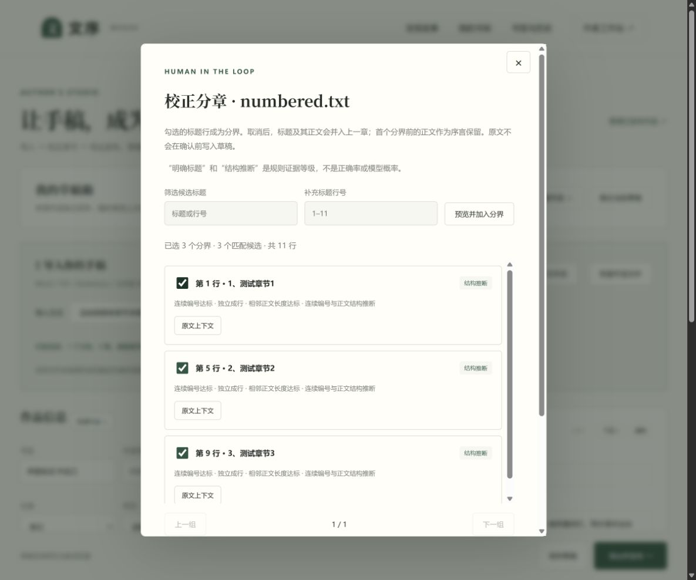

# 文序 Wenxu · 小说阅读与出版

**NagasakiSaki 的个人项目**：从本地手稿导入、自动识别和校正章节，到公开发表与手机阅读。

[在线体验](https://nagasakisaki.github.io/wenxu-fiction/) · [安卓下载与离线安装](https://nagasakisaki.github.io/wenxu-fiction/#/app) · [正式版本](https://github.com/NagasakiSaki/wenxu-fiction/releases) · [开发者指南](docs/developer-guide.md) · [结构引擎技术说明](docs/structure-engine.md) · [更新记录](CHANGELOG.md) · [引用与依赖](REFERENCES.md)

## 项目亮点

| 模块 | 已实现能力 |
| --- | --- |
| 结构引擎 3.1 | 整篇结构分析、标题示例学习、候选证据、目录匹配、完整性核对、原文点选标题与精确断点 |
| 作者工作台 | 多格式与文件夹导入、光标及多断点拆章、按篇幅建议断点、编号顺延、相邻合并与撤销、多作品草稿、自动保存、回收站和备份 |
| 阅读体验 | 手机滑屏分页、首尾导航、字号字体行距、日夜模式、章节筛选 |
| 阅读管理 | 书架、段落书签与备注、删除恢复、全书搜索、历史续读和备份迁移 |
| 本地应用 | 安卓离线APK、Windows可安装PWA、共用草稿JSON双向迁移、安卓私有文件保存与系统文件选择器 |
| 发布与验证 | GitHub Pages自动部署、所有者签名安卓构建、作品校验、106项Node测试、3项离线设备测试、可复现结构评测 |

技术特点是将“跨格式结构分析、可解释证据、作者修正和公开验证”连成完整流程。实现不使用大模型服务，不将规则等级包装成正确率，不声称自动分章的学术首创。当前评测包括22份合成结构样例：18份自动分析样例中17份分界完全匹配，边界F1为0.96；另外4份作者示例辅助样例单独统计，已知失败案例与评测范围一并公开。详见[技术说明与基准结果](docs/structure-engine.md)。

## 当前产品形态

v2.3.0 / 结构引擎3.1：导入后点击“在原文中点选分章”，可直接选择标题行或正文中的断点，目录即时预览，支持搜索、撤销与取消；手机同样可用，确认前不改草稿。

v2.2.0 / 结构引擎3.0：加入本书标题示例学习与反例、争议候选确认、整书篇幅/编号/重复正文体检、目录正文匹配、卷章节目次、正文覆盖核对及场景线索断点。规则随草稿文件迁移，安卓与网页均在本机运行。入口及可复现结果见[结构引擎说明](docs/structure-engine.md)。

v2.1.0 增加独立本地书架：工作台点击“存入本地书架并阅读”，即可生成离线阅读副本；在书架直接导入作品 JSON / 草稿备份，也可导出作品文件跨设备阅读。草稿与阅读副本分开保存，同编号更新保留阅读身份、书签和进度。安卓启动默认进入书架。

v2.0.0 提供安卓本地创作应用与可安装的 Windows 桌面 Web 应用（PWA，非EXE），不依赖账号。APK内置资源，PWA首次联网缓存完成后可离线；两端通过 `wenxu-draft-v1` 文件互通，导入另存独立草稿。安装、备份、限制及开发说明见[本地应用与文件互通](docs/local-apps.md)。

独立公开阅读平台，无读者账号。作品以 JSON 存储在 `content/books/`，由仓库维护者提交，通过 GitHub Actions 校验并部署 GitHub Pages。所有公开文件及提交历史均可被访问，请勿上传私人草稿。

## 使用

Node.js 24。运行 `npm ci`、`npm run dev`；构建 `npm run build`；测试 `npm test`。首次部署需在仓库 Settings → Pages 将 Source 设为 GitHub Actions。

运行 `npm run benchmark` 复现结构评测。默认部署路径为 `/wenxu-fiction/`，换域名或子路径时需同时检查 `vite.config.js` 的 `base`、PWA清单与离线回退路径。架构、数据契约、扩展方法、安卓测试及发布流程见[开发者指南](docs/developer-guide.md)，具体版本变化见 [CHANGELOG.md](CHANGELOG.md)。

作者工作台支持 DOCX、TXT、Markdown 和文字型 PDF（10 MB、200 万字符，PDF 最多100页），按中文章节、英文 Chapter、Markdown 标题分章。扫描件需先 OCR；Word 图片不会导入。请核对章节识别结果。章节正文当前按纯文本呈现，Markdown 标记会原样显示。

支持单文档、多选文档和整个文件夹导入（包含子文件夹）。每批最多100个支持格式的文件、合计50 MB；隐藏文件、Word临时文件和不支持的格式会跳过并列出。按文件夹层级、阿拉伯数字/中文数字章节、英文罗马数字自然排序，例如 `第一卷/2.txt`、`第一卷/10.txt`、`第二卷/1.txt`。单个文件内部继续自动分章并保留文档原顺序，没有章节标题时以文件名作章名。文件夹名作为空白作品的默认书名。

分章先分析整篇结构：优先使用明确的“第N章/回/集/幕/话/篇”、Chapter、Episode、EP 标题，支持 `### 【第1章：标题】`、Word 加粗普通段落及 `【第12集】标题`；忽略章内大纲、小节、区间说明和“第N章完”等结束注记。只有没有明确章节时才使用同级 Markdown 标题回退，代码围栏里的标题不参与识别。书名、副标题及标注的作品资料提取为作品信息，不让分隔线独立生成空章；真正的序言正文仍保留为序言。大纲、视角说明与章末注记不自动删除。预览显示识别方式和原文行号；提取资料保存在草稿及草稿备份的 `importNotes` 中，公开作品导出会移除这些资料和标题示例规则。单文档在作品书名为空时优先使用识别出的书名。

解析完成后显示文件顺序、章节列表及失败/跳过原因，确认导入前保留原草稿。默认追加，也可选择替换全部章节。解析失败的文件不会被悄悄丢弃，需明确选择「仅导入成功的章节」。合并后仍受1000章、200万字符限制，超限不会截断或覆盖原草稿。不支持文件夹选择的浏览器可以使用多选文档。这里的“上传”在浏览器本地解析；公开发布仍需作者在 GitHub 确认提交。

结构引擎2.0增加没有“第N章”时的连续数字标题推断，并显示每个候选的识别依据。可查看原文上下文、勾选或取消分界、按行号补充分界、恢复自动分析，再确认导入。浏览器工作线程承担结构分析；脱敏结构报告不包含标题、正文和文件路径。无编号、无格式的纯文字章名仍需作者手动选择。

长篇也可先整篇导入，再在正文中放置光标，点击「从光标处拆为下一章」或按 Ctrl / ⌘ + Enter。断点后的全部文字自动移入新章，后续同类编号可顺延；提供预览、自定义章名、相邻合并、会话撤销和独立备份。详见[光标拆章与合并](docs/chapter-workshop.md)。

导入后编辑资料、章节标题和正文，可以新增、删除、调整顺序和预览。草稿箱支持多作品独立存放、搜索、切换、复制、备份导出和可恢复的回收站；新建作品自动保留已有草稿。清空全部章节前会自动建立「清空前备份」。输入停止约700毫秒后保存到当前浏览器的 IndexedDB，兼容迁移旧草稿，手动保存等待写入完成。未完成草稿可导出专用备份 JSON，公开发表仍需完整资料。

发布：点击「发布到公开网站」，下载 JSON，再由 NagasakiSaki 登录 GitHub 上传至 `content/books` 并 Commit changes 到 main。Actions 成功后网站自动更新。更新同一作品必须保留原编号和文件名，可从仓库下载其 JSON 后在工作台「恢复作品文件」。删除作品需删除对应 JSON 并提交；旧提交仍留有历史。

网页草稿与本地阅读副本保存在 IndexedDB，安卓保存在应用私有文件；阅读设置、进度和书签等使用浏览器或 WebView 的本地存储。普通读者无需登录。当前没有多作者账号、付费、评论或自动跨设备同步；非作者不能通过前端直接修改线上作品。

阅读页的章节首尾都提供上一章、目录和下一章；手机提供滚动阅读及左右翻页模式。滑屏模式先翻当前章的页面，再进入相邻章；同时提供按钮与键盘操作。阅读设置含字号、字体、行距、主题及手机目录，按章节、段落和文字位置记录进度，切换字号和阅读模式后尽量恢复当前位置。滚动阅读工具栏固定在顶部，方便随时添加书签。详细设计与验证见 [阅读器和草稿箱](docs/reading-and-drafts.md)。

书签支持附近摘录、备注、搜索、软删除和恢复；阅读工具支持全书正文搜索并直接定位，章节目录可过滤。首页、书架和作品详情可继续阅读，「书签与历史」集中管理记录，并支持导出/导入备份。阅读备份只包含书签和历史，不包含作品正文或作者草稿；数据仍保存在当前浏览器，没有云端自动同步。

默认包含一篇明确标识的原创体验短篇。正式作品准备好后可以删除该示例。前端没有密钥或访问令牌；发布权限依赖 GitHub 仓库访问控制。上传者编辑章节时所有文字都经过 HTML 转义，避免执行文档脚本。

## 相关项目调研

参考 [raikyou/novel-parser](https://github.com/raikyou/novel-parser) 的章节模式与无标题回退、[rockbenben/novel-processor](https://github.com/rockbenben/novel-processor) 的章节识别和重排功能。当前实现为本站独立编写的浏览器端代码，没有复制这些项目源码或引入其后端依赖。

完整参考与依赖列表见 [REFERENCES.md](REFERENCES.md)。技术说明、限制和本地扫描验证命令见 [文档导入技术说明](docs/import-engine.md)。维护者：NagasakiSaki。
