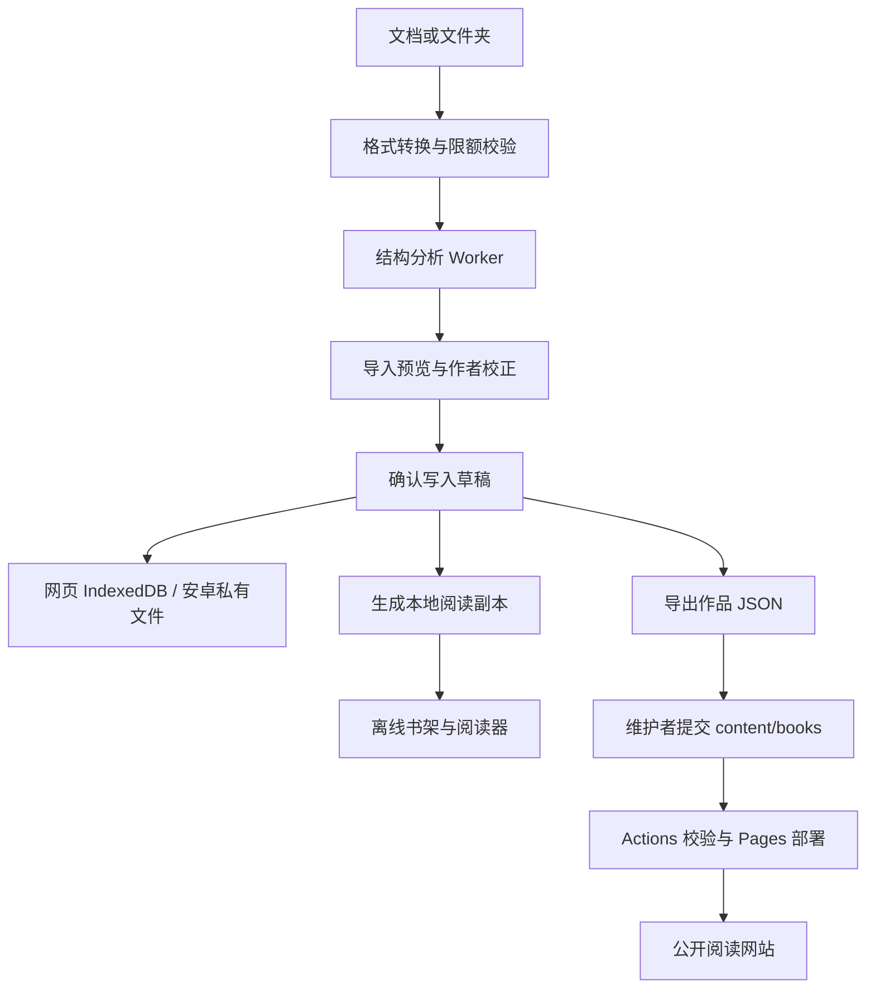

# 文序开发者指南

本文面向接手维护、扩展分章算法、开发阅读体验或构建安卓应用的开发者。以 **应用 v2.3.0、结构引擎 v3.1.0** 的实现为基准；依赖版本以 `package-lock.json` 为准，测试数量以实际输出为准。

文序使用原生 JavaScript ES Modules、Vite、IndexedDB 和 Capacitor。网页与安卓共用创作、分章和阅读代码，平台差异集中在文件访问、存储及生命周期适配层。

## 目录

- [1. 开发环境与首次运行](#1-开发环境与首次运行)
- [2. 架构与代码入口](#2-架构与代码入口)
- [3. 文档导入与结构引擎](#3-文档导入与结构引擎)
- [4. 原文点选分章的实现约束](#4-原文点选分章的实现约束)
- [5. 数据契约与本地存储](#5-数据契约与本地存储)
- [6. 常见扩展任务](#6-常见扩展任务)
- [7. 测试与评测](#7-测试与评测)
- [8. 安卓开发](#8-安卓开发)
- [9. 部署与版本发布](#9-部署与版本发布)
- [10. 安全、依赖与排障](#10-安全依赖与排障)

## 1. 开发环境与首次运行

网页开发需要 Node.js 24、npm 和 Git，无需数据库或服务端环境变量。

```powershell
git clone https://github.com/NagasakiSaki/wenxu-fiction.git
cd wenxu-fiction
npm ci
npm run dev
```

打开终端显示的地址，默认是 `http://127.0.0.1:5173/wenxu-fiction/`。创作入口为 `#/studio`，书架为 `#/shelf`。端口被占用时，以 Vite 输出为准。

| 命令 | 用途 |
| --- | --- |
| `npm run dev` | 启动本地开发服务 |
| `npm test` | 运行 Node 内置测试套件 |
| `node scripts/validate-books.mjs` | 校验公开作品、重复编号与文件名 |
| `npm run build` | 生成网页/PWA 到 `dist/` |
| `npm run preview` | 预览 `dist/`，默认端口 4173 |
| `npm run benchmark` | 输出合成样例的结构评测 |
| `npm run build:native` | 生成 `dist-native/`，同步资源与插件到安卓工程 |

`predev`、`prebuild` 和 `prebuild:native:web` 会执行 [`scripts/prepare-document-assets.mjs`](../scripts/prepare-document-assets.mjs)，从已安装依赖复制 PDF 字体、字符映射、WASM 和许可证。请使用 npm 脚本构建；只调用 `vite build` 可能漏掉这些准备步骤。

当前产品没有账号系统、在线数据库或自动云同步。公开书籍来自仓库文件；创作资料保存在本机。Windows 版本是可安装 PWA，安卓版本是内置网页资源的 APK。

## 2. 架构与代码入口



| 位置 | 职责 |
| --- | --- |
| [`src/main.js`](../src/main.js) | 启动、hash 路由、页面渲染、工作台状态与功能装配 |
| [`src/document-import.js`](../src/document-import.js)、[`src/document-model.js`](../src/document-model.js) | 文件类型、编码、格式转换与文档安全检查 |
| [`src/batch-import.js`](../src/batch-import.js) | 文件夹排序、批量解析、失败清单和整批容量检查 |
| [`src/import-ui.js`](../src/import-ui.js)、[`src/import-review.js`](../src/import-review.js) | 导入交互、候选校正、示例学习和确认流程 |
| [`src/chapter-analysis.js`](../src/chapter-analysis.js) | 分章主算法与来源行号 |
| [`src/structure-evidence.js`](../src/structure-evidence.js)、[`src/structure-intelligence.js`](../src/structure-intelligence.js) | 编号证据、目录匹配、层级与完整性核对 |
| [`src/heading-profile.js`](../src/heading-profile.js) | 本书标题正反例与可迁移规则 |
| [`src/visual-source-model.js`](../src/visual-source-model.js)、[`src/visual-source-ui.js`](../src/visual-source-ui.js) | 原文点选标题、精确断点与实时预览 |
| [`src/chapter-edit.js`](../src/chapter-edit.js)、[`src/break-suggestions.js`](../src/break-suggestions.js) | 拆章、合并、编号顺延和篇幅/场景断点建议 |
| [`src/work-health.js`](../src/work-health.js) | 整书重复、篇幅和编号体检 |
| [`src/draft-store.js`](../src/draft-store.js)、[`src/draft-manager.js`](../src/draft-manager.js) | 草稿持久化、草稿箱、回收站和备份协议 |
| [`src/local-books.js`](../src/local-books.js)、[`src/local-books-core.js`](../src/local-books-core.js) | 本地书架与稳定阅读身份 |
| [`src/reading-data.js`](../src/reading-data.js)、[`src/reading-library.js`](../src/reading-library.js) | 书签、历史与阅读备份 |
| [`src/platform-runtime.js`](../src/platform-runtime.js)、[`src/local-app.js`](../src/local-app.js) | 平台检测、PWA 更新与原生生命周期 |
| [`src/native-documents.js`](../src/native-documents.js)、[`src/file-export.js`](../src/file-export.js) | 安卓文件选择/另存为与网页下载适配 |
| [`content/books/`](../content/books/) | 进入公开站点的作品 JSON |
| [`tests/`](../tests/)、[`benchmarks/`](../benchmarks/) | 自动化回归与公开合成样例 |
| [`android/`](../android/) | Capacitor 原生工程、文件桥接与设备测试 |

主要路由：`#/` 发现页、`#/book/:id` 作品详情、`#/read/:id/:chapter` 阅读页、`#/studio` 创作、`#/shelf` 书架、`#/library` 书签与历史、`#/app` 安装说明。阅读路由还支持位置参数。安卓无 hash 启动时进入书架，PWA 清单的启动入口是工作台。

公开作品通过 `import.meta.glob` 在构建时载入。修改本地 JSON 后需要重新构建并部署，线上没有接收稿件的上传 API。新增功能宜将纯数据逻辑放入独立模块，页面只负责事件、状态和渲染，避免继续扩大 `main.js` 的职责。

## 3. 文档导入与结构引擎

### 3.1 转换与批量处理

1. TXT/Markdown：识别带 BOM 的 UTF-16；先尝试严格 UTF-8，失败后使用 GB18030。
2. DOCX：先检查 ZIP 元数据，再由 Mammoth 转 HTML，经 DOMPurify 清理后由 Turndown/GFM 转 Markdown；图片替换为提示，不保留原始版式。
3. PDF：本地 PDF.js 提取文字，拼接页面内容。只支持可提取文字的 PDF，不包含 OCR；复杂多栏版式可能出现顺序偏差。
4. 批量导入先按目录层级与章节编号自然排序，再分别分析文件内部结构。`prepareImport` 保留成功来源、失败项、跳过项和警告。

| 限额 | 当前实现 |
| --- | --- |
| 文件格式 | `.txt`、`.md`、`.markdown`、`.docx`、文字型 `.pdf`；不支持旧版 `.doc` |
| 单文件/整批 | 10 MiB；整批最多 100 个支持文件、50 MiB |
| PDF | 最多 100 页 |
| DOCX ZIP 检查 | 最多 2000 个条目，声明解压体积合计最多 40 MiB |
| 单部作品 | 最多 1000 章、正文合计 2,000,000 个 UTF-16 code unit |
| JSON 导出 | UTF-8 编码后最多 32 MiB |

显示字数会去除空白，与容量检查的 `body.length` 不是同一指标。`document-model.js` 还保留文章相关辅助函数，小说容量应以 [`src/limits.js`](../src/limits.js) 和 `validateBook` 为准，不要套用文章的 60,000 字符常量。

### 3.2 分章流程与结果

UI 通过 [`runChapterAnalysis`](../src/chapter-engine.js) 调用模块 Worker，完成或失败后销毁 Worker；超时为 30 秒。没有 Worker 的环境使用相同纯函数分析，不拥有工作线程隔离带来的中断能力。

算法依据整篇结构选择标题：明确章节语义优先，再考虑连续编号、同级 Markdown 标题和本书示例。代码围栏、章末结束语和目录等需单独处理；卷与章内小节进入层级信息。无编号、无格式又没有示例的任意短句，仍可能需要人工选点。

`analyseChapters(text, options)` 的主要返回字段：

| 字段 | 含义 |
| --- | --- |
| `chapters` | 章名、正文、来源行号及可选卷/小节信息 |
| `boundaryLines`、`candidates` | 已选标题行及候选证据 |
| `frontMatter`、`archivedLines` | 提取归档的前置资料及其来源位置 |
| `diagnostics`、`metrics` | 风险提示与结构统计 |
| `hierarchy`、`contentsMatches` | 卷章节结构、目录与正文匹配 |
| `integrity` | 转换后源文本的正文与归档覆盖核对 |
| `profile` | 当前作品的标题示例规则 |

标题示例为有界、可序列化的 `wenxu-heading-profile-v1` 数据：2–12 个正例、最多 12 个反例。它归纳编号、包装符与相邻上下文等特征，没有远程模型调用，也不执行用户提供的任意正则。

完整性检查针对**转换后的文本**，不能证明 DOCX/PDF 转换没有丢失图文或版式。候选置信等级是规则证据，不是预测正确率。更多原理、失败案例和评测定义见[结构引擎说明](structure-engine.md)与[导入说明](import-engine.md)。

## 4. 原文点选分章的实现约束

此功能分为纯模型 `visual-source-model.js` 和交互层 `visual-source-ui.js`，不直接编辑原始文档。

```js
import {analyseVisualPlan} from './src/visual-source-model.js';

const result = analyseVisualPlan('第一章 开始\n正文甲。正文乙。', {
  fallbackTitle: '示例',
  visualPlan: {
    headingLines: [1],
    splitOffsets: [11]
  }
});
// result.chapters 的正文依次为“正文甲。”、“正文乙。”
```

标题行号使用 **1 起始**；`splitOffsets` 使用统一换行后的原文、**0 起始 UTF-16 偏移**。示例偏移 11 位于“正文甲。”之后。它们不是文件字节、Word 页码或 Unicode 码点序号。

模型先规范化 BOM/换行并按选定标题生成基础章节，再将原文偏移映射到排除了标题和归档资料的正文。逐章拆分复用 `splitChapterAtPoints`，继承卷信息并处理后续编号。最终要求拆分前后各章正文直接拼接完全一致。

维护时必须保持以下约束：

- 拒绝重复、越界、落入标题/归档资料、空章边缘或 Unicode 代理对内部的断点。
- 所有来源重新合并后再检查整部容量；不能仅验证当前文件。
- 分析失败保留上一次可用预览。采用点选方案只替换导入提案，最终“确认导入”才写入草稿。
- 异步结果写入前检查当前草稿、页面与弹窗状态，防止旧任务覆盖新操作。
- 长文按约 12,000 个 UTF-16 单元分段显示，优先换行且保护代理对。不要将当前显示段的局部偏移误当全局偏移。
- 最近 20 步撤销记录保存方案，不复制整部正文。搜索与目录跳转只改变查看位置。

跨行选标题、同一行多断点、长单行、表情字符、目录归档和卷继承都需要回归。章节内容经过后续编辑时，旧来源定位可能失效，不能将历史来源行号视作永久编辑坐标。

## 5. 数据契约与本地存储

### 5.1 四类文件与身份

| 类型 | 标识与用途 | 不包含/注意事项 |
| --- | --- | --- |
| 公开作品 JSON | `id` 与 `chapters` 等作品字段；阅读或提交仓库 | 公开导出移除 `draftKey`、`chapterProfiles`、`importNotes` |
| 草稿备份 JSON | `format: "wenxu-draft-v1"`，包含 `draft`、导出时间和平台 | 允许未完成资料，保留示例规则及导入资料；恢复时生成新 `draftKey` |
| 阅读备份 JSON | `format: "wenxu-reading-backup-v1"`，包含 `data` | 仅书签与历史，不含作品正文或作者草稿 |
| 结构报告 JSON | `format: "wenxu-structure-report-v1"` | 统计、位置及规则证据；不含标题、正文、路径，不能用来恢复手稿 |

不要混用三种身份：`id` 是作品的可移植编号；`draftKey` 是本机草稿实例身份；本地阅读副本的 `local-…` 编号是阅读身份，其 `sourceId` 指回原作品。更新同一作品应保留原 `id`，使阅读副本继续使用稳定身份。草稿备份不是加密文件。

可直接通过 `validateBook` 的最小公开作品示例，保存为 `content/books/example-book.json`：

```json
{
  "id": "example-book",
  "title": "示例作品",
  "author": "作者笔名",
  "category": "小说",
  "intro": "用于说明公开作品数据结构。",
  "status": "连载中",
  "updated": "2026-10-17",
  "chapters": [
    {"title": "第一章 开始", "body": "这里是第一章正文。"}
  ]
}
```

编号满足 `^[a-z0-9-]{3,80}$`；书名/章名最多 100 字符、笔名最多 60、分类最多 30、简介最多 1000。公开作品书名、笔名、章名、正文需非空；状态为“连载中”或“已完结”。文件名必须是 `<id>.json`。`updated` 是展示用日期，不能替代版本控制或冲突检测。可选的卷、小节字段由层级模块处理。

### 5.2 存储后端

| 数据 | 网页/PWA | 安卓 |
| --- | --- | --- |
| 多作品草稿 | IndexedDB `wenxu-manuscripts` v1，`drafts` store | `Directory.Data` 下 `drafts/index.json` 与 `drafts/snapshots/` |
| 本地阅读副本 | IndexedDB `wenxu-local-books` v1，`books` store | 独立的 `books/index.json` 与 `books/snapshots/` |
| 书签与历史 | localStorage `wenxu-reader-data-v1` | WebView localStorage，同协议 |
| 收藏、阅读设置与位置 | `wenxu-shelf`、`wenxu-progress`、`wenxu-settings`、`wenxu-reading-position` 等 localStorage 键 | WebView localStorage |

网页数据库键中 `current` 存当前草稿，`draft:<key>` 存正文记录，`summary:<key>` 存草稿箱摘要。已有旧 `wenxu-draft` 的迁移逻辑，调整数据库时要保留兼容路径。

写入通过队列串行化。网页的 `storeDraftWithBackup` 在同一个 IndexedDB 事务内写备份与新状态；安卓的 [`native-store-core.js`](../src/native-store-core.js) 先写不可变快照，再通过临时清单重命名提交索引。不要改为先覆盖正文再补写备份；清单损坏也不能静默重置为空。

编辑停止约 700 毫秒后自动保存；手动保存和关键切换需要等待持久化。回收站是软删除。独立阅读副本只在用户存入书架时生成或更新，不随草稿每次输入实时改变。书签使用章节与段落等信息恢复位置，重排或改写后只能尽量定位，不能保证历史锚点绝对不变。

清除站点数据、清除应用数据或卸载会导致本机内容丢失；导出的文件才是独立备份。不同域名、浏览器和开发端口拥有不同存储空间。变更存储结构或备份协议时，需要明确版本、迁移和失败回退；请用旧格式样例验证兼容性。

## 6. 常见扩展任务

| 任务 | 推荐入口与完成标准 |
| --- | --- |
| 增加标题模式 | 修改分析/证据模块；用最小合成文档加入正例和相似正文反例，再验证整个候选集与正文覆盖 |
| 改进示例学习 | 在 `heading-profile.js` 保持规则有界、可序列化；验证草稿备份往返与反例排除 |
| 增加文档格式 | 实现本地文本转换，接入类型及安全/容量校验；批量与安卓选择入口同时适配，保留失败原因 |
| 调整拆章/合并 | 优先修改 `chapter-edit.js`；验证原文、编号、卷归属、空章拒绝和保存前备份 |
| 增加阅读偏好 | 在读取时提供默认值，验证旧设置、手机布局、分页及位置恢复；不要扩大正文的 localStorage 使用 |
| 调整书架更新 | 保持 `sourceId` 与稳定本地 ID，验证同书更新后的书签和进度 |
| 添加云端能力 | 需要单独设计后端、鉴权、访问控制与冲突合并；当前本机存储接口不提供这些保证 |

建议使用“纯逻辑 → Node 回归 → UI 接线 → 手机交互 → 涉及原生时设备验证”的顺序。不要为一个异常文档直接加入过宽正则；先解释它为何是标题，并补充可能被误判的正文。

## 7. 测试与评测

常规代码变更的基础检查：

```powershell
npm test
node scripts/validate-books.mjs
npm run build
```

定向回归可以执行 `node --test tests/visual-source.test.js`、`node --test tests/chapter-edit.test.js` 等。v2.3.0 的 Node 套件为 102 项，覆盖分章、长篇、批量顺序、编辑、阅读和存储；IndexedDB 测试使用 `fake-indexeddb`，不能代替真实浏览器和安卓文件系统验证。

结构算法修改还应执行：

```powershell
npm run benchmark
# 明确需要更新已提交报告时再执行，并检查结果差异：
node scripts/benchmark-structure.mjs docs/structure-benchmark.json
```

当前公开评测有 22 份合成样例：18 份自动分析样例中 17 份边界完全匹配，边界 F1 为 0.96；另外 4 份包含作者示例辅助，应分别阅读其操作成本与结果。不能把辅助结果当作完全自动识别准确率，也不能将标题边界评测外推为格式转换准确率、任意真实文档表现或手机性能。报告保留已知失败案例。

涉及导入 UI 时，至少手动覆盖：单文件、文件夹、混合成功/失败、取消、追加/替换、超限、切换草稿后的旧任务返回；原文点选还需验证搜索、跨显示段、撤销、采用与最终确认的区别。阅读改动检查章节首尾导航、手机滑动、字号变化与续读。

私有手稿不能提交到测试、评测报告、截图或公开问题中。先制作保留结构特征的合成样例；`.artifacts/` 是忽略目录，可放本机验证产物。

## 8. 安卓开发

需要 JDK 21、Android SDK 36、兼容的 Android Studio 或命令行工具。当前 `minSdkVersion=26`、`targetSdkVersion=36`，Capacitor 配置的最低 WebView 版本是 119；环境要求以 [`android/variables.gradle`](../android/variables.gradle) 和 [`capacitor.config.json`](../capacitor.config.json) 为准。

```powershell
# 仓库根目录：每次前端变更后都需要重新构建并同步
npm run build:native
cd android
.\gradlew.bat :app:assembleDebug
.\gradlew.bat :app:testDebugUnitTest
# 连接模拟器或设备后
.\gradlew.bat :app:connectedDebugAndroidTest
```

本地 SDK 可通过 `ANDROID_HOME` 或未提交的 `android/local.properties` 指向。调试 APK 位于 `android/app/build/outputs/apk/debug/`。打开 Android Studio 时选择 `android/` 工程。

原生构建使用相对资源路径并将 `virtual:pwa-register` 替换为 `src/no-pwa.js`，不注册 PWA Service Worker。APK 内置 `dist-native/` 的产物，不加载线上网站作为主页面；只运行 Gradle 不会自动更新前端代码。

自定义 [`DocumentAccessPlugin.java`](../android/app/src/main/java/io/github/nagasakisaki/wenxu/DocumentAccessPlugin.java) 通过 SAF 提供目录选择与另存为，不依赖整盘存储权限。目录遍历限深 24、最多检查 5000 个节点，并继续执行文件数与体积限制。文件选择取消必须按取消处理，不得提示保存成功。`MainActivity` 负责注册插件和窗口适配。

[`OfflineCreationTest.java`](../android/app/src/androidTest/java/io/github/nagasakisaki/wenxu/OfflineCreationTest.java) 包含 3 项设备测试：离线批量导入与草稿往返、标题示例保存复用、原文点选标题/光标断点/撤销/导入。CI 在 API 35 模拟器上关闭 Wi-Fi 和移动数据后执行；它不代表所有实体设备兼容性。

测试文件提供器位于 `src/debug/`，不得移入正式构建。文件选择与文本光标相关测试使用真实触摸事件，不能用直接改业务状态替代。Gradle 命令保留 `:app:` 前缀，避免误跑传递库的设备测试。

## 9. 部署与版本发布

### 9.1 GitHub Pages 与公开作品

[`pages.yml`](../.github/workflows/pages.yml) 在 `main` 推送或手动触发时执行：`npm ci` → 测试 → 作品校验 → 网页构建 → Pages 部署。仓库 Settings → Pages 的 Source 应设为 GitHub Actions。

发布作品时，在工作台选择“发布到公开网站”，导出作品 JSON，由拥有仓库权限的维护者提交到 `content/books/<id>.json`。Actions 成功后对所有访问者可见。更新保留编号；删除文件只影响新构建，旧提交仍公开可访问。

网页/PWA 有离线缓存，已打开的客户端可能需要确认更新；[`local-app.js`](../src/local-app.js) 在应用更新前尝试保存草稿。不要为追求立即刷新跳过保存与更新确认。

Fork 或更换部署路径时，需要一起检查 `vite.config.js` 的 `base`、PWA manifest 的 `id`、`scope`/启动路径和 Workbox `navigateFallback`；还要检查 `src/model.js` 的仓库所有者/仓库名及页面中的硬编码 GitHub、下载链接。原生的相对路径配置应保持独立。只改 Vite `base` 不能保证 PWA 子路径离线可用。

### 9.2 安卓 CI 与签名

[`android.yml`](../.github/workflows/android.yml) 对前端、安卓、资源、脚本、测试和构建配置等路径变更触发，也支持手动运行。纯 Markdown 文档变更通常只触发 Pages。

| 作业 | 产物或检查 |
| --- | --- |
| `package` | 测试、原生同步、`:app:assembleRelease`、`:app:testDebugUnitTest`，输出 APK、SHA-256 与签名报告 |
| `offline-device-test` | API 35 离线模拟器运行 `:app:connectedDebugAndroidTest`，上传设备测试报告 |

正式签名使用 Actions Secrets：`ANDROID_KEYSTORE_BASE64`、`ANDROID_KEYSTORE_PASSWORD`。CI 临时还原 keystore，并向 Gradle 提供 `ANDROID_KEYSTORE_PATH`、`ANDROID_KEYSTORE_PASSWORD`；密钥别名为 `wenxu`。不要把真实密码、密钥或其 Base64 写入文档、命令历史、仓库或日志。

当前应用 ID 为 `io.github.nagasakisaki.wenxu`，版本为 `versionName "2.3.0"` / `versionCode 20300`。覆盖安装更新必须沿用应用 ID 与原签名密钥，并提高 versionCode。普通开发者用 debug 构建验证；独立发行应使用自己的应用身份和签名，不替换维护者正式密钥。

### 9.3 维护者发布流程

1. 更新 `package.json`/锁文件版本、安卓 `versionName`/`versionCode`、应用展示版本和 CHANGELOG；只有算法协议变化时才调整结构引擎版本。
2. 完成相关测试、作品校验、网页与原生构建；检查变更中没有私有手稿、密钥和本机产物。
3. 提交并推送，等待 Pages、安卓打包和离线设备测试成功。下载 `wenxu-android` artifact，核对签名证书指纹与 SHA-256。
4. 以**完整提交 SHA** 创建 GitHub Release 草稿，上传 `wenxu-android.apk`、校验与签名报告，按需上传网页构建 ZIP；审阅说明后发布。
5. 检查线上资源与下载链接。应用下载入口使用稳定资产名 `wenxu-android.apk`，更改资产名时需同步入口。

CI 生成构建 artifacts，不会自动发布 GitHub Release。可用 `gh run list`、`gh run view <run-id>` 查看结果，`gh run download <run-id> --name wenxu-android --dir <输出目录>` 下载。纯文档更新无需提升应用版本或重新发布 APK。

## 10. 安全、依赖与排障

所有导入内容都应视为不可信数据。继续保留 DOCX HTML 清理、正文/标题输出转义、JSON 校验及解压/容量限额；不要把原文直接赋给 `innerHTML`。静态前端没有保存 GitHub 访问令牌的安全位置，公开发布权限依赖仓库访问控制。

依赖与功能参考记录在 [REFERENCES.md](../REFERENCES.md)。分章与本地存储是本仓库独立实现；Mammoth、Turndown、DOMPurify、PDF.js、Capacitor 和 Workbox 等保留各自许可证。新增依赖时更新锁文件与参考清单，并确认分发包需要携带的许可证。仓库公开不自动等于已经授予任意再分发许可，复用代码前应核对项目许可状态。

| 问题 | 优先检查 |
| --- | --- |
| 本地页面 404 或静态资源失效 | 是否使用 `/wenxu-fiction/` 路径；开发/网页/原生构建模式是否匹配 |
| PDF 字体、WASM 请求失败 | 是否 `npm ci` 后通过 npm 脚本准备资源，部署子路径与离线缓存是否正确 |
| TXT 乱码 | 原文件编码与 BOM；当前解码不覆盖所有历史编码，可先另存 UTF-8 |
| 长文分章不理想 | 区分格式转换与结构识别；查看候选、完整性和整书体检，提供标题示例或直接原文选点 |
| 原文断点错位 | 全局/分段偏移、换行规范化、UTF-16 与代理对；先运行视觉分章回归测试 |
| 草稿看似丢失 | 当前浏览器/端口/域名是否变化、是否换了应用身份或清过数据；先检查草稿箱与备份，不要清库排障 |
| 保存失败 | 等待错误提示，检查存储空间与事务；先导出备份，避免继续覆盖 |
| APK 仍显示旧界面 | 先执行 `npm run build:native`，再运行 Gradle，确认安装的是新 APK |
| 无法覆盖安装 APK | 对比应用 ID、versionCode 和签名证书；不要将卸载作为默认解决办法，以免删除本地数据 |
| PWA 未显示新版本 | 检查部署是否完成、更新提示及缓存状态；更新前保存草稿 |

进一步阅读：[结构引擎](structure-engine.md)、[文档导入](import-engine.md)、[拆章工作台](chapter-workshop.md)、[阅读与草稿箱](reading-and-drafts.md)、[本地应用与文件互通](local-apps.md)。
