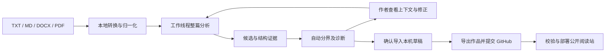

# 文序结构引擎 2.0

维护者：NagasakiSaki。实现见 `src/chapter-analysis.js`、`src/structure-evidence.js`、`src/chapter-worker.js`、`src/import-review.js`。

## 技术贡献

文序的技术重点是浏览器内、可解释且可校正的小说文档结构分析。它是独立实现的规则和结构推断引擎，没有使用大模型、训练模型或外部推理服务；不声称发明自动分章，也不声称学术首创。

1. **跨格式结构归一化**：TXT 解码、Markdown 层级及 DOCX 标题/加粗转换到统一文字结构；保留原文行号用于核对。此处行号是转换后文本的行号，不是 Word 页码。
2. **整篇证据优先级**：明确章节语义优先于章内小节；Markdown 同级结构作回退；书名、题记和序言分别处理；代码围栏与章末完成标记不作新章。
3. **编号、排版和正文联合推断**：没有明确章名时，至少三个独立数字标题，连续递增转移比例及相邻正文长度达标比例均至少80%，正文跨度至少80个非空白字符，才采用推断。可以识别 `1、雨夜`、`一、雨夜`，避免仅凭数字把短大纲拆成章节。长列表仍可能满足条件，必须核对。
4. **可解释与可恢复的作者校正**：显示候选、是否采用、证据等级、上下文和行号；允许取消误切边界、按行号补充分界、恢复自动建议。未选的标题保留在相邻正文，分界前正文保留为序言；方案先在内存中重算并校验限额，确认后才写入草稿。
5. **结构诊断和脱敏报告**：提示跳号、重号、重复标题、空边界、极短章、极长章和缺乏分界。它们是核对提示，不是错误结论；不会擅自删除目录或修改章节顺序。报告包含引擎版本、候选依据、分界行和统计，不含文件路径、标题和正文。
6. **长文工作线程**：浏览器支持 Worker 时，在独立线程执行结构分析和校正，30秒超时中止。解析转换、DOM渲染和草稿写入仍有主线程工作；这不代表整个导入过程完全无卡顿。不支持 Worker 的环境使用同一引擎回退。

“明确标题”“结构推断”“需核对”是规则证据等级，不是统计置信度，也不是识别正确率。校正不会训练模型或悄悄改变下一部作品的规则。

## 数据流



## 可复现验证

```sh
npm test
npm run benchmark
node scripts/benchmark-structure.mjs docs/structure-benchmark.json
```

基准样例位于 `benchmarks/structure-cases.mjs`，均为合成文本，可公开复现。最新完整结果见 [structure-benchmark.json](structure-benchmark.json)。

在12份合成结构样例中，11份标题行分界完全匹配；边界F1约0.936。脚本内定义的单条中文章名正则基线F1约0.457。这里的基线只用作规则对照，不代表任何外部项目。未匹配样例为“没有编号和格式的纯文字章名”，保留在评测中，不为追求分数删除。指标只衡量样例中的标题行边界，不衡量字符解码、Word/PDF转换或真实文档总体正确率。

脚本还测量161万字符、1000章合成长文的分析耗时，结果记录具体 Node 版本和当次耗时；不是手机导入耗时，也不是跨设备性能承诺。

另在维护者指定的82份本地 MD/TXT/DOCX 文档上运行解析回归；文件名中可识别的章节数量约束通过。私有作品和详细审计报告不上传仓库；该检查不等于逐章人工标注的准确率评测。

## 当前边界

- 无编号、无格式的普通文本标题无法可靠区分旁白，默认整篇导入，可手动添加分界。
- 目录与正文可能重复标题，当前提示作者处理，不自动丢弃文字。卷内重编号、真实短章和番外也需要作者判断。
- 不提供OCR；扫描PDF、图片和复杂双栏需先转换核对。正文仍以纯文本阅读。
- 作品上限1000章、200万字符；单文件10MB、一批100个文件/50MB。报告与导入方案不代替草稿备份。
- 当前为维护者发布、读者自由访问的静态平台；没有多作者账号、在线直传公开、付费或云同步。

已有项目的设计参考与依赖许可见 [REFERENCES.md](../REFERENCES.md)。
